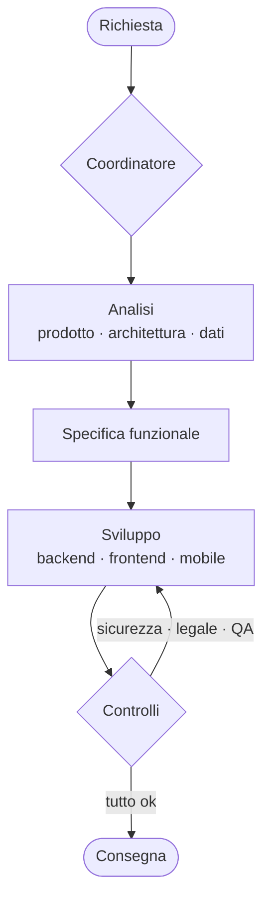

  

<a href="README.md">🇬🇧 English</a> · <b>🇮🇹 Italiano</b>

  
  

> [!NOTE]
> Questo repository è una **vetrina del progetto**: il codice sorgente è privato. Una demo è disponibile su richiesta.

## 🧭 Panoramica

Una **software house virtuale** in cui ogni dipendente è un agente AI con un ruolo preciso: product owner, architetto, sviluppatori, QA, security engineer, DPO, compliance officer e altri.

Ogni richiesta (una nuova app, una modifica a un progetto esistente o una semplice domanda) segue lo stesso percorso di un'azienda vera: **analisi → specifica funzionale → sviluppo → controlli → consegna**.

Il principio guida: oggi chiunque scrive codice con l'AI. La differenza la fa **come** è scritto. Sicurezza e conformità legale hanno **potere di veto**: niente viene consegnato finché entrambe non sono a posto.

## ✨ Funzionalità principali

- 👥 **21 ruoli AI specializzati**, ognuno con le sue skill, i suoi strumenti e le sue regole
- 🧭 **Smistamento intelligente**: un agente coordinatore chiama solo i ruoli che servono davvero e scrive chi ha coinvolto e perché
- 🛡️ **Controlli obbligatori** che non si possono saltare: scansione dei segreti a ogni commit, revisione di sicurezza su autenticazione e API, DPO sui dati personali, compliance su cookie, pagamenti e funzioni AI, accessibilità sulle interfacce pubbliche
- 🧠 **Modello per ruolo**: Opus per le decisioni ad alto rischio, Sonnet per il lavoro di tutti i giorni, Haiku per i compiti ripetitivi, con un modello minimo imposto dal codice
- 🏢 **Dashboard 3D in tempo reale**: un ufficio virtuale in cui guardi gli agenti lavorare
- ✅ **Sviluppata con TDD**: oltre 400 test Python automatici più test end-to-end nel browser

## 🏗️ Come funziona

## 🧰 Tecnologie

## 📬 Contatti

Realizzato da **Salvatore Cutaia**, ingegnere informatico specializzato in agenti AI e automazioni.

