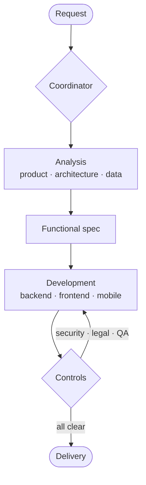

  

<b>🇬🇧 English</b> · <a href="README.it.md">🇮🇹 Italiano</a>

  
  

> [!NOTE]
> This repository is a **project showcase**: the source code is private. A demo is available on request.

## 🧭 Overview

A **virtual software house** where every employee is an AI agent with a precise role: product owner, architect, developers, QA, security engineer, DPO, compliance officer and more.

Any request (a new app, a change to an existing project, or a simple question) goes through the same path as in a real company: **analysis → functional spec → development → controls → delivery**.

The guiding principle: today anyone can write code with AI. The difference is **how** it is written. Security and legal compliance have **veto power**: nothing ships until both are clean.

## ✨ Key features

- 👥 **21 specialized AI roles**, each with its own skills, tools and rules
- 🧭 **Smart routing**: a coordinator agent picks only the roles a request really needs, and writes down who was called and why
- 🛡️ **Mandatory controls** that can never be skipped: secret scanning on every commit, security review on auth and APIs, DPO on personal data, compliance on cookies, payments and AI features, accessibility on public UI
- 🧠 **Model per role**: Opus for high-risk decisions, Sonnet for everyday work, Haiku for repetitive tasks, with a minimum model enforced in code
- 🏢 **3D live dashboard**: a virtual office where you watch the agents work in real time
- ✅ **Built with TDD**: 400+ automated Python tests plus end-to-end browser tests

## 🏗️ How it works

## 🧰 Tech stack

## 📬 Contact

Built by **Salvatore Cutaia**, Computer Engineer specialized in AI agents & automations.

